

<a href="https://suryanshmishra.vercel.app"></a>

  
<a href="https://github.com/smirk-dev"></a>
<a href="https://github.com/smirk-dev"></a>
<a href="https://github.com/smirk-dev?tab=repositories"></a> 
<a href="https://github.com/smirk-dev/Guide-to-levelling-up-on-Github"></a> 
<a href="https://github.com/smirk-dev/BharatChain"></a> 
<a href="https://github.com/smirk-dev/CodeReview-AI-Agent"></a> 
<a href="https://github.com/smirk-dev/gemini-hackathon"></a> 
 
<a href="https://github.com/smirk-dev/Spot-The-Scam-AI"></a> 
 
<a href="https://github.com/smirk-dev/obsidian-legible-files"></a> 
<a href="https://github.com/smirk-dev?tab=repositories"></a>
 
<a href="./achievements/certificates.md"></a>
<a href="./achievements/kaggle.md"></a>
<a href="./achievements/leetcode.md"></a>
<a href="./achievements/gssoc.md"></a>
 

  

<!-- Every card above is generated by scripts/board.mjs (config: scripts/board.config.json) in .github/workflows/profile-cards.yml. Edit the config, not the SVGs. -->
