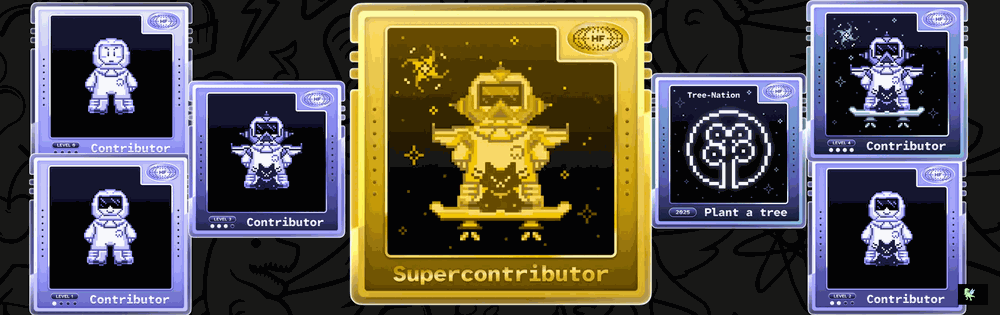
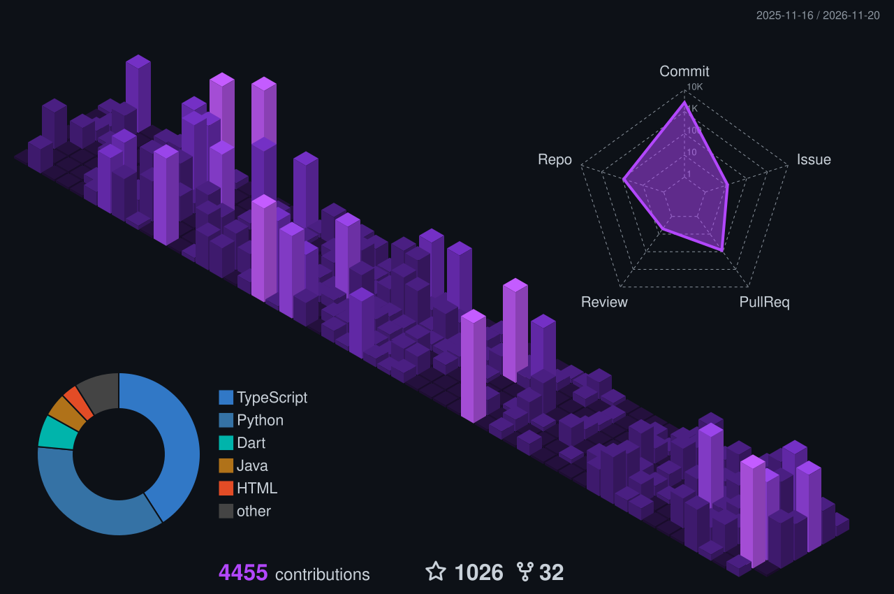

# 🎃 Community, events and trophies

Hacktoberfest, Holopin, GitHub trophies and the 3D contribution calendar.

<a href="https://github.com/smirk-dev"><b>← Back to the profile board</b></a>

    
  
    
  
  

### 🏆 GitHub Trophies

  

### 📈 3D Contribution Calendar

  

<a href="https://github.com/smirk-dev"><b>← Back to the profile board</b></a>

