

# 🔥 LeetCode badges

Badges plus the live submission heatmap.

<a href="https://github.com/smirk-dev"><b>← Back to the profile board</b></a>

<table style="border-collapse: collapse; border-spacing: 0;">
  <tr>
    <td align="center" style="padding: 5px;">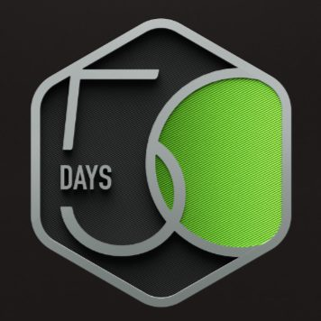</td>
    <td align="center" style="padding: 5px;">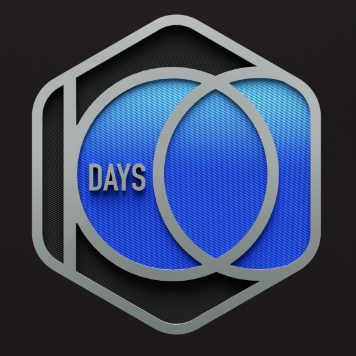</td>
    <td align="center" style="padding: 5px;">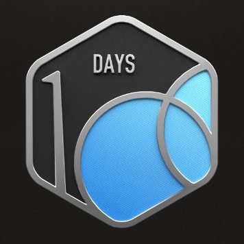</td>
    <td align="center" style="padding: 5px;">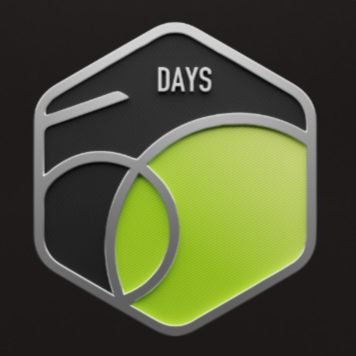</td>
    <td align="center" style="padding: 5px;">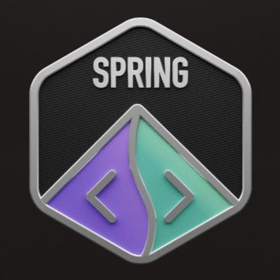</td>
    <td align="center" style="padding: 5px;"></td>
  </tr>
  <tr>
    <td align="center" style="padding: 5px;">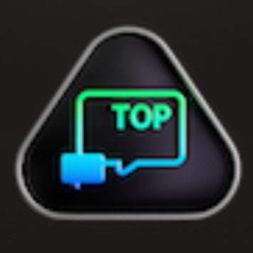</td>
    <td align="center" style="padding: 5px;"></td>
    <td align="center" style="padding: 5px;">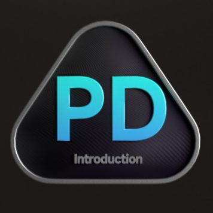</td>
    <td align="center" style="padding: 5px;"></td>
    <td align="center" style="padding: 5px;">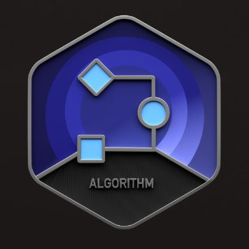</td>
    <td align="center" style="padding: 5px;">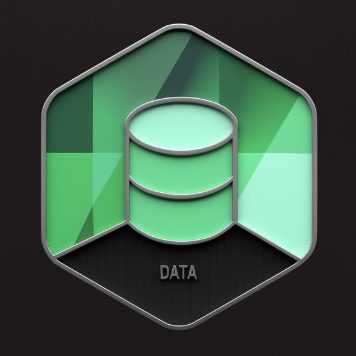</td>
  </tr>
  <tr>
    <td align="center" style="padding: 5px;">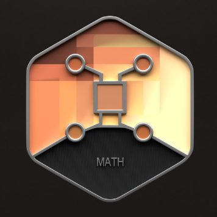</td>
    <td align="center" style="padding: 5px;">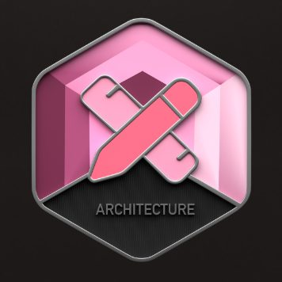</td>
    <td align="center" style="padding: 5px;">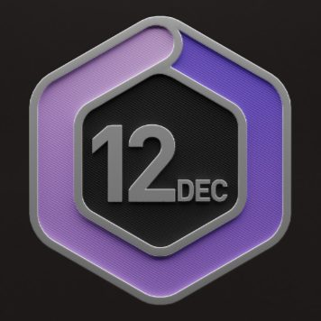</td>
    <td align="center" style="padding: 5px;"></td>
    <td align="center" style="padding: 5px;"></td>
    <td align="center" style="padding: 5px;"></td>
  </tr>
  <tr>
    <td align="center" style="padding: 5px;"></td>
    <td align="center" style="padding: 5px;"></td>
    <td align="center" style="padding: 5px;"></td>
    <td align="center" style="padding: 5px;">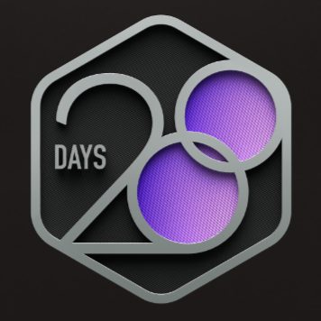</td>
    <td align="center" style="padding: 5px;"></td>
    <td align="center" style="padding: 5px;"></td>
  </tr>
</table>
 

  

<a href="https://github.com/smirk-dev"><b>← Back to the profile board</b></a>

